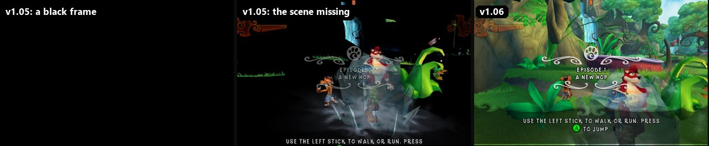
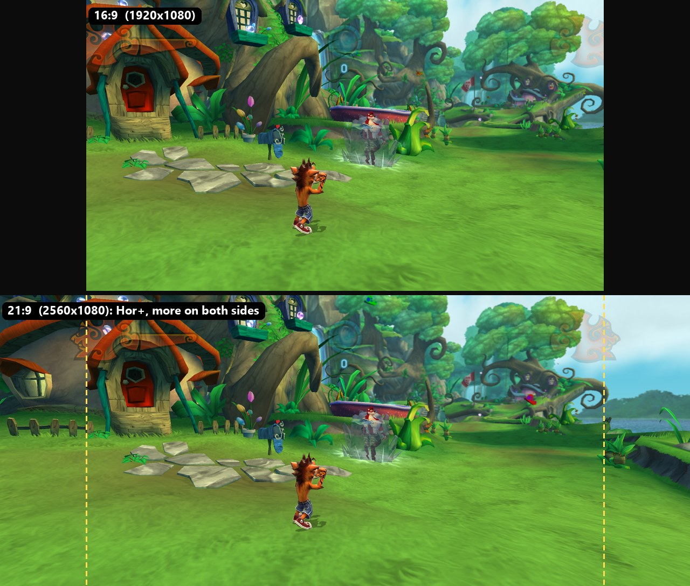
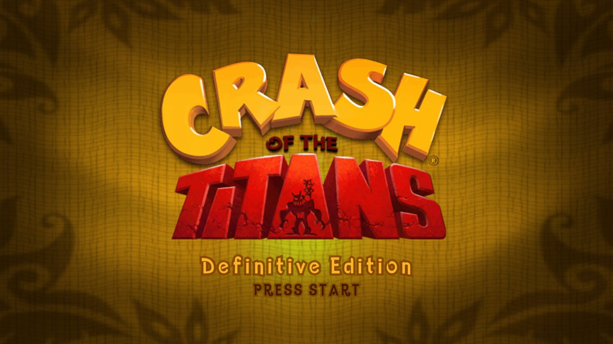
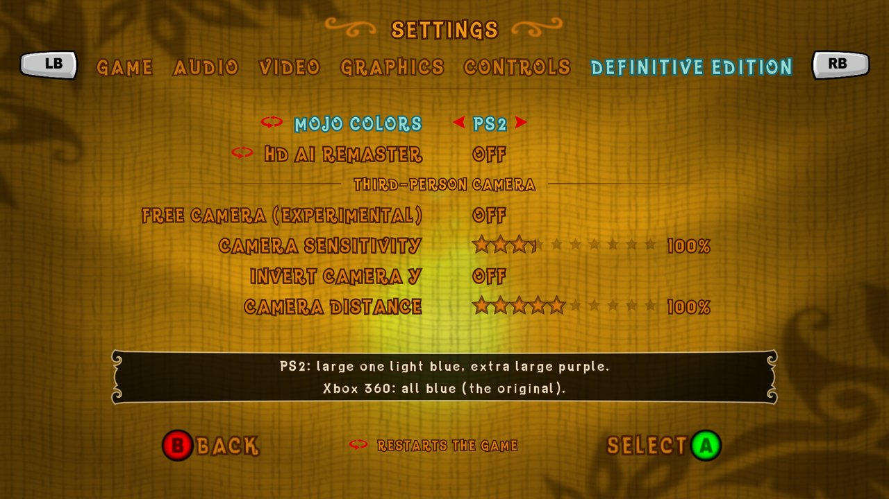
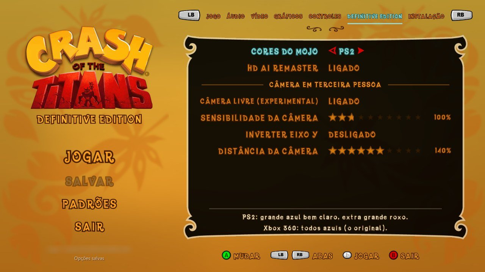
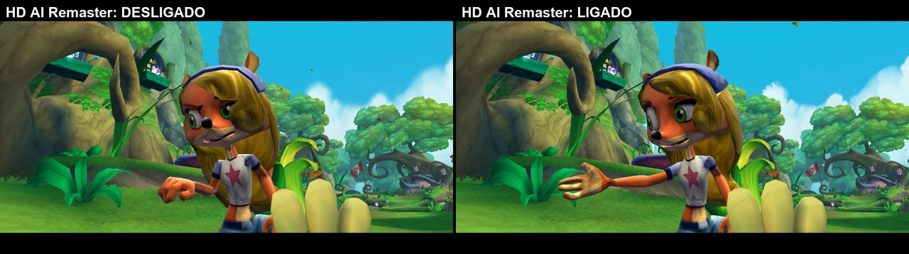
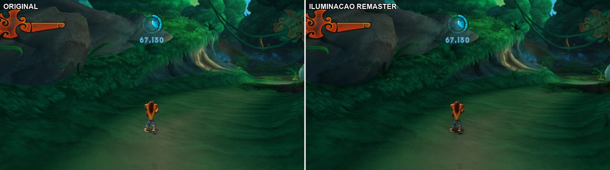
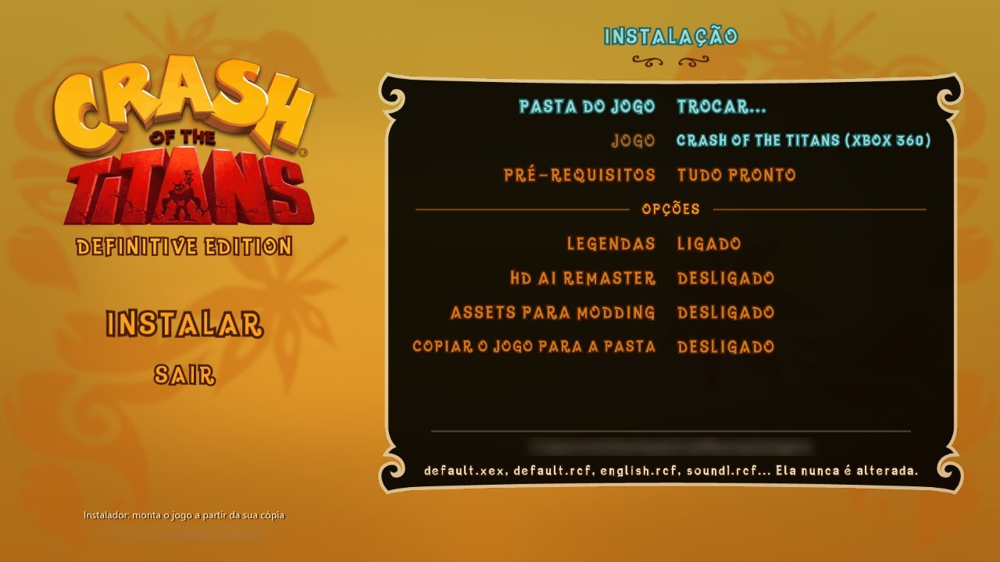

# CrashRecomp: Crash of the Titans, Definitive Edition (PC)

A native Windows port of **Crash of the Titans** (Xbox 360), made by statically recompiling the game's
PowerPC code to x86-64 with [XenonRecomp](https://github.com/hedge-dev/XenonRecomp), plus a runtime that
replaces the Xbox 360 (graphics, audio, input, files, saves) and a set of PC improvements.

**[Português do Brasil abaixo](#português-do-brasil)**

> ### v1.07: Linux / Steam Deck installer, colour subtitles and a reviewed PT-BR
>
> - **Linux and Steam Deck** (in testing): **`CrashSetup-v1.07-x86_64.AppImage`**, the same installer
>   screens as on Windows, built from your own copy of the game (see "Linux and Steam Deck" below).
> - **Subtitles**: the speaker's name in their own colour, overlapping lines shown together, more reading
>   time for short lines, and subtitles on the voice clips that share their audio with another. The Brazilian Portuguese texts were
>   reviewed (enemy and titan names, titles, jokes and moves).
>
> Already on v1.05 or v1.06? Click **UPDATE** in the launcher: your saves and settings stay, and the new
> subtitles are installed.

> ### v1.06: Intel integrated GPUs fixed, and much faster on them
>
> - **No more black flicker on Intel integrated GPUs** ([issue #3](https://github.com/VitoMiguelF/crashott-pc/issues/3)):
>   their driver read the draw constants past 128 MB of the upload ring as zeros, so about half of the
>   frames went black or lost the scene. 455 of 901 frames before, 0 now.
> - **Faster shaders**: the game's shaders with jumps and loops are translated to plain structured code
>   instead of a state machine. On an Intel UHD: 34.8 -> 59.1 fps at 1280x800, 20.9 -> 36.4 fps at 1680x1050.
>
> Already on v1.05? Click **UPDATE** in the launcher.
>
> 

> ### v1.05: a single .exe, ultrawide, no shader stutter, and updates from the launcher
>
> - **A single `.exe`**: download only `CrashSetup-<version>.exe` and run it. No zip to extract, nothing else to
>   install, offline; it asks where to install, makes the shortcuts and installs DLSS only on a GPU that
>   runs it.
> - **Ultrawide (21:9, 32:9) and 16:10 with Hor+**: the same vertical view, more of the world on both
>   sides, nothing stretched or cropped. The HUD and menus stay at 16:9 in the middle (or the HUD
>   corners at the screen's edges), menu backgrounds fill the screen, and videos play at 16:9 between
>   black bars. SETTINGS > VIDEO > ASPECT RATIO (AUTO follows the monitor).
> - **Shaders compiled in the background**: the first time an effect appeared, the game used to stop to
>   build it (~34 ms each, up to 1.6 s in one frame in the village, and all of it again after every
>   driver update). Now each part is compiled once, linked in under 1 ms and optimized on a worker
>   thread, and the pipelines of earlier sessions are rebuilt at start: **no hitches** in the village or
>   level 3, cold cache or not. GRAPHICS > SHADER COMPILATION (SYNCHRONOUS brings back the old way).
> - **UPDATE in the launcher**: when a new release is out, the launcher shows it; one click downloads
>   only the new installer `.exe`, checks it and installs over the same folder, keeping saves, options and
>   mods.
>
> 
>
> v1.04 made the game almost 3x faster (one-pass scene, native D3D command building: ~180 -> ~500 fps
> in the village on a Ryzen 7 5700X + RTX 5080); next is replacing the remaining Xbox 360 GPU emulation
> with direct Direct3D-to-Vulkan calls ([the plan](docs/internals/native-gpu-plan.md#road-to-100-native)).



> **No game files are included.** You need your own legally obtained copy of Crash of the Titans for
> Xbox 360. The installer builds everything from **your** copy on **your** PC. This repository has only
> original code, tools and documentation. Crash of the Titans is © Activision / Radical Entertainment;
> this is an unofficial fan project, not affiliated with or endorsed by them.

## Features

- **Native PC game**: story, menus and saves run natively, at the original 30 fps or unlocked
  (60 / 120 / unlimited), in a window, borderless or fullscreen, at internal resolutions up to 4K.
- **Ultrawide and 16:10**: 21:9 (2560x1080, 3440x1440...), 32:9 (5120x1440...) and 16:10 (1280x800, Steam
  Deck) with a wider view (Hor+), the HUD and menus kept at 16:9 in the middle (or the HUD corners at the
  screen's edges), menu backgrounds filling the screen and the videos at 16:9 between black bars.
  SETTINGS > VIDEO > ASPECT RATIO (AUTO follows the monitor).
- **DLSS / DLAA** (NVIDIA RTX) and **FSR 3.1** (any GPU) upscaling, FXAA / SMAA, anisotropic filtering,
  adjustable motion blur, depth of field and shadow softness.
- **Fast native rendering path**: the scene is drawn in one pass instead of the Xbox 360's three screen
  tiles, the game's Direct3D command building runs as native code and its shaders are compiled at install
  and warmed up in the background. In the heaviest scene (the first level's village, unlimited FPS) this
  went from ~170 to ~500 fps on a Ryzen 7 5700X + RTX 5080.
- **No shader stutter**: new effects are compiled in the background (Vulkan graphics pipeline libraries)
  and the pipelines of earlier sessions are rebuilt at start, so a first visit or a driver update doesn't
  freeze the game (GRAPHICS > SHADER COMPILATION; SYNCHRONOUS brings back the old behaviour).
- **PC controls**: keyboard and mouse with rebindable keys, mouse camera, mouse in every menu, Xbox and
  **PlayStation (DualSense)** controllers, button icons that follow the last device used, and **local
  co-op** with two controllers (choose who is player 1 and player 2 in SETTINGS > CONTROLS).
- **Native settings screen** in the game's own style (GAME, AUDIO, VIDEO, GRAPHICS, CONTROLS and
  DEFINITIVE EDITION tabs), plus a **launcher** before playing: a simple page with the main options
  (language, resolution, FPS limit, HD AI Remaster, lighting ORIGINAL / REMASTER) and an ADVANCED view
  with every tab of the settings screen (the same rows and texts: both read `runtime/settings/options.*`).
- **Brazilian Portuguese translation** of every text, and **subtitles** for all dialogue and cutscenes
  (English transcript + PT-BR translation, optional download).
- **Definitive Edition extras**: PS2 mojo colours, an experimental **free third-person camera**, a
  **lighting remaster** (SSAO, one-bounce indirect light, contact and soft shadows), EXIT GAME, an
  on-screen keyboard for names and save deletion, and **skippable cutscenes and intro videos** (hold
  B / Esc; a small prompt shows in the corner).
- **HD AI Remaster** (optional download, ~4.5 GB): AI-upscaled textures and smoothed models for the
  whole game.
- **Modding**: mods folder with load order, HD texture packs, and tools that export the game's sounds,
  videos, textures and 3D models to open formats (WAV, MP4, PNG, glTF) and build them back into mods.
- **Dev tools for automation**: test profiles with direct boot into any level, event-anchored input
  scripts, screenshots, input recording (F5), Lua inside the game's own scripting, benchmarks, and an
  optional **in-game developer console** (unlock all, mojo, god mode, teleport, level select, live skin
  switching, including the unused green **Crash Hulk** skin the game never shipped).

| Settings | Launcher |
|---|---|
|  |  |

| HD AI Remaster (off / on) | Lighting remaster (before / after) |
|---|---|
|  |  |

## Requirements

- Windows 10/11 x64 and a GPU with **Vulkan 1.3** and an up-to-date driver (for example NVIDIA GTX 900
  or newer, AMD RX 400 or newer, Intel Iris Xe / Arc). The renderer is Vulkan only (Direct3D 12 was
  dropped in October 2026). A native **Linux / Steam Deck** version is in testing (below).
  **DLSS** needs an NVIDIA RTX GPU; on other GPUs the installer leaves it out and the options offer
  **FSR 3.1** (any GPU above) or no upscaler.
- Your Crash of the Titans (Xbox 360) game files: the folder with `default.xex`, `default.rcf`,
  `english.rcf`, `sound1.rcf`, `sound2.rcf` and `shaders\` (extracted from your disc). Only the known
  retail `default.xex` is supported (the installer checks its SHA-256).
- About 4.3 GB of free space (1.3 GB + the 3 GB copy of your game; the installer shows what your
  options need: plus 9.5 GB for the HD AI Remaster, 18 GB for the asset export, mostly WAV sounds).

**One file, nothing else to install.** Since v1.05 the installer is a single `CrashSetup-<version>.exe`
with everything inside: our source, the build tools ([llvm-mingw](https://github.com/mstorsjo/llvm-mingw)
clang, [CMake](https://cmake.org), [Ninja](https://ninja-build.org) and the official embeddable
[Python](https://www.python.org) with numpy and Pillow) and the libraries (FFmpeg LGPL, AMD FSR,
Microsoft's `dxcompiler.dll`, NVIDIA DLSS; see [THIRD_PARTY_NOTICES.md](THIRD_PARTY_NOTICES.md)). No
Visual Studio, LLVM, Python or Git, nothing is installed on the system, and it works offline: only the
optional subtitles and HD AI Remaster are downloaded. It ships no game file and no recompiled code: the
game is built on your PC from your own copy.

Advanced: to build with an installed Visual Studio 2022+ / Build Tools and LLVM `clang-cl` instead, set
**BUILD TOOLS = VISUAL STUDIO** in the installer (or `--toolchain msvc`); it offers to install the missing
ones with `winget`.

### Linux and Steam Deck (in testing)

A native Linux version is being tested: the same game, the same launcher and the same installer
screens, made for the Steam Deck first. It comes as **`CrashSetup-<version>-x86_64.AppImage`**: one
file with everything inside (zig as the compiler, CMake, Ninja, Python, FFmpeg, DXC, SDL3), so nothing
is installed on the system; like on Windows it builds the game from your own copy. Run it in the
Steam Deck's desktop mode (or any desktop), install (default `~/Games/Crash of the Titans Definitive
Edition`), then right click the launcher in the applications menu: **Add to Steam** puts it in Game Mode.

- **DLSS** works on NVIDIA RTX GPUs with NVIDIA's driver.
- **FSR 3.1 is not available on Linux for now**: AMD ships no Linux library and it isn't built from
  AMD's source yet. On the Steam Deck (AMD) and other non-RTX GPUs the game runs without an upscaler.
- Not on Linux yet: the launcher's UPDATE (run the new AppImage over the install instead).
- It needs **glibc 2.38 or newer**: SteamOS 3.8, Arch, Fedora 39, Ubuntu 24.04 or later.

Details for developers: [docs/internals/linux_port.md](docs/internals/linux_port.md).

## Install

1. Download **`CrashSetup-v1.07.exe`** (the latest, ~210 MB, one file) from the
   [releases](https://github.com/VitoMiguelF/crashott-pc/releases). (Up to v1.04 it was a zip with
   `CrashSetup.exe` inside; a `git clone` of this repository: see [CONTRIBUTING.md](CONTRIBUTING.md).)
2. Run it. It first asks for your **game folder** and checks it is the supported Xbox 360 dump. Choose **where to install** (default `%LOCALAPPDATA%\Programs\Crash of the Titans Definitive
   Edition`; any folder or drive of yours, the space needed and free is shown; your game is copied into
   the install), the options (subtitles, HD AI Remaster, asset export for modding) and
   click **INSTALL**. It unpacks its files there, recompiles the game code and builds everything (about
   3 minutes on an 8-core PC, longer on slower ones). The installer checks your GPU: DLSS is installed
   only on an NVIDIA RTX card (NVIDIA's own check); elsewhere you get FSR 3.1.
3. At the end it asks for a **desktop shortcut** and a **Start menu** entry for the launcher.

   What it installs (only what building and running the game needs; docs, tests and development tools
   stay on GitHub):

   ```
   Crash of the Titans Definitive Edition\
     CrashLauncher.exe            the launcher (the shortcuts point here)
     CrashOTTDE.exe               the game
     *.dll                        FFmpeg, FSR, dxcompiler (+ DLSS on NVIDIA RTX)
     game\                        your game files, copied here
     userdata\                    saves, settings.toml, shader cache
     mods\
     CrashRecomp\                 languages\, data\, licencas\ and what the game is built with
                                  (toolchain\, build\, the source; the asset export's tools only with
                                  ASSETS FOR MODDING)
   ```

   

   Without the GUI, the same in a terminal from a clone or the release zip's folder, with the bundled Python:

   ```bat
   toolchain\python\python.exe tools\setup.py --game D:\Games\Crash --subtitles
   toolchain\python\python.exe tools\setup.py --game D:\Games\Crash --remaster --extract-assets --copy-game
   toolchain\python\python.exe tools\setup.py --game D:\Games\Crash --assets-only   :: retry only the asset export
   ```

   Release zips placed next to `CrashSetup-<version>.exe` are used instead of downloading them again. If
   only the asset export fails, the game is installed anyway: **TRY AGAIN** reruns just that step. To
   update, use **UPDATE** in the launcher's menu: it shows when a new release is out, downloads only
   its installer and runs it on the same folder (your saves and settings in `userdata\` stay). Running
   the new installer on the same folder by hand does the same.
4. Play with the shortcut, **`CrashLauncher.exe`** (options, then PLAY) or `CrashOTTDE.exe`. (A clone
   built with `tools\setup.py` plays from `dist\`: `dist\CrashLauncher.exe`, `dist\CrashRecomp.exe`.)

### Known issues

- **Windows Security flags `XenonRecomp.exe` (`Program:Win32/Contebrew.A!ml`) and the install stops at
  the recompile step.** It is a false positive: the installer compiles `XenonRecomp.exe` on your PC from
  [XenonRecomp](https://github.com/hedge-dev/XenonRecomp)'s open source code (the download has no
  `XenonRecomp.exe` in it), and the `!ml` means Defender's machine-learning guess about a new, unsigned
  program, not a known threat. In **Windows Security > Virus & threat protection > Protection history**,
  open the item and choose **Actions > Allow** (or **Restore**), then run the installer again (finished
  steps are skipped). If it happens again, add an exclusion for the install folder's `CrashRecomp	ools`
  folder.

- **v1.01: ASSETS FOR MODDING fails with `ModuleNotFoundError: No module named 'numpy'`.** The v1.01
  installer doesn't install the Python packages the asset export needs (fixed in v1.02). The game
  itself is installed fine. Install them and run the installer again (finished steps are skipped):

  ```bat
  python -m pip install numpy pillow
  ```

  Use the same Python the installer uses: if `python` isn't found or is a different one, try
  `py -3 -m pip install numpy pillow`.
- **Black screen flicker on some GPUs (reported on an Intel UHD iGPU, issue #3).** With the game closed,
  set `gpu_safe_mode = "on"` and `gpu_diagnostics = true` under `[video]` in `userdata\settings.toml`.
  The safe mode turns off the renderer's riskier optimizations (it costs some FPS); the diagnostics
  write `userdata\crashrecomp_log.txt` (GPU, driver, limits) to attach to the issue. If the safe mode
  helps, a list instead of `"on"` (`"barriers"`, `"serial"`, `"present"`, ...) narrows down which part
  does it. `tools\gpu_report.bat` runs all of these in turn and packs the logs into `gpu_report.zip`.

## Playing

`dist\` is the game folder: `CrashLauncher.exe`, `CrashRecomp.exe`, `game\` (your dump, if copied),
`mods\`, `userdata\` (saves, `settings.toml`, shader cache), `languages\`, `data\` (subtitles, HD AI
Remaster). Nothing depends on where the project is. Shortcuts in game: F1 overlay, F12 screenshot,
Alt+Enter fullscreen, F8 lighting remaster on/off, and with **DEFINITIVE EDITION > DEVELOPER CONSOLE** on
(off by default, or `--dev-console`), the key left of 1 or F10 opens the developer console (`help`).

Default settings are the original experience (1280x720, 30 fps, no upscaler, extras off). Turn things on
in **SETTINGS** (main menu or pause > OPTIONS) or in the launcher; for the HD AI Remaster, install it and
then switch **DEFINITIVE EDITION > HD AI REMASTER** on. The launcher opens on its simple view: **LIGHTING
REMASTER** turns on the whole lighting remaster (SSAO high, indirect light, contact and soft shadows),
ORIGINAL turns it off, and CUSTOM means a mix set one by one; **ADVANCED** (bottom-right corner, or Y / F2)
shows every option, and the launcher remembers the last view. Mods' HD texture packs need no option: they
load from `mods\` by themselves (`[graphics] hd_textures = false` in `settings.toml` turns them off).

## Mods and exporting the game's assets

Put each mod in `dist\mods\<name>\` (optional `load_order.txt`). Mods can replace any `.rcf` entry, add
HD textures without touching the game files, or replace sounds.

The game's assets are **not** distributed, but you can export them from your own copy (installer option
**ASSETS FOR MODDING**, or with the bundled Python, which already has numpy and Pillow):

```bat
set PY=toolchain\python\python.exe
%PY% tools\assets.py all          :: everything to private\assets (about 9 minutes, 18 GB)
%PY% tools\textures.py export     :: or step by step: textures -> PNG
%PY% tools\models.py export       :: models, skeletons, animations -> glTF (.glb)
%PY% tools\audio.py export        :: sounds and voices -> WAV
%PY% tools\audio.py videos        :: Bink videos -> MP4
```

(Another Python 3.11+ works too after `python -m pip install -r tools\requirements.txt`.)

Edit the exported files and build them into a mod with `textures.py build`, `models.py build` or
`audio.py build --mod <name>`. The full guide (formats, indexes, examples) is in
[docs/GUIA_DO_PROJETO.md](docs/GUIA_DO_PROJETO.md), section "Extraindo e modificando assets" (PT-BR).
Mods made from the game's files are derived content: share them with care.

## Documentation

- [docs/GUIA_DO_PROJETO.md](docs/GUIA_DO_PROJETO.md): the full project guide (PT-BR): layout, building by
  hand, test profiles (`tools\run_game.py`), every feature and setting, performance, modding, reading
  the game's code.
- [runtime/NOTES.md](runtime/NOTES.md): the runtime's development notes (PT-BR), step by step.
- [docs/dev_features.md](docs/dev_features.md): developer console, Lua, invincibility, teleport, unlocks, skins.
- [docs/internals/](docs/internals/README.md): short English cheat sheets of addresses, hooks and traps per area.
- [CONTRIBUTING.md](CONTRIBUTING.md): setting up, branches and pull requests, tests, reporting bugs.

## Credits and licenses

- Code of this project: MIT ([LICENSE](LICENSE)), by VitoMiguelF, written with Claude Code.
- Build toolchain in the installer: llvm-mingw (Apache 2.0 with LLVM Exceptions; mingw-w64), CMake
  (BSD-3), Ninja (Apache 2.0), Python (PSF) with NumPy (BSD-3) and Pillow (MIT-CMU).
- [XenonRecomp](https://github.com/hedge-dev/XenonRecomp) by hedge-dev (MIT), with local fixes in
  [patches/XenonRecomp.patch](patches/XenonRecomp.patch).
- FFmpeg (LGPL), NVIDIA DLSS (RTX SDK license), AMD FidelityFX FSR, SMAA (MIT), Dear ImGui (MIT), SIMDe,
  libmspack, tiny-AES-c: see [THIRD_PARTY_NOTICES.md](THIRD_PARTY_NOTICES.md).
- The subtitles and the HD AI Remaster are optional fan-made release assets, kept out of git so they can
  be removed on request.

---

# Português do Brasil

Um port nativo para Windows de **Crash of the Titans** (Xbox 360), feito recompilando estaticamente o
código PowerPC do jogo para x86-64 com o [XenonRecomp](https://github.com/hedge-dev/XenonRecomp), mais
um runtime que faz o papel do Xbox 360 (gráficos, áudio, controles, arquivos, saves) e várias melhorias
de PC.

> ### v1.07: instalador para Linux / Steam Deck, legendas coloridas e PT-BR revisado
>
> - **Linux e Steam Deck** (em teste): **`CrashSetup-v1.07-x86_64.AppImage`**, com as mesmas telas do
>   instalador do Windows, montando o jogo a partir da sua cópia (veja "Linux e Steam Deck" abaixo).
> - **Legendas**: o nome de quem fala com a cor do personagem, falas sobrepostas aparecendo juntas, mais
>   tempo de leitura nas falas curtas e legenda nas falas que dividem o áudio com outra. Os textos em português do
>   Brasil foram revisados (nomes de inimigos e titãs, títulos, piadas e golpes).
>
> Já está na v1.05 ou na v1.06? Clique em **ATUALIZAR** no launcher: seus saves e configurações ficam, e as
> legendas novas são instaladas.

> ### v1.06: GPUs Intel integradas corrigidas, e bem mais rápidas
>
> - **Acabou a tela preta piscando nas GPUs Intel integradas** ([issue #3](https://github.com/VitoMiguelF/crashott-pc/issues/3)):
>   o driver delas lia como zeros as constantes dos desenhos depois de 128 MB do anel de upload, então
>   cerca de metade dos quadros ficava preta ou sem o cenário. Eram 455 de 901 quadros; agora, 0.
> - **Shaders mais rápidos**: os shaders do jogo com saltos e laços são traduzidos para código estruturado
>   comum em vez de uma máquina de estados. Numa Intel UHD: de 34,8 para 59,1 fps em 1280x800 e de 20,9 para
>   36,4 fps em 1680x1050.
>
> Já está na v1.05? Clique em **ATUALIZAR** no launcher.
>
> 

> ### v1.05: um .exe só, ultrawide, sem engasgo de shader e atualização pelo launcher
>
> - **Um `.exe` só**: baixe apenas o `CrashSetup-<versão>.exe` e abra. Sem zip para descompactar, nada mais para
>   instalar, offline; ele pergunta onde instalar, cria os atalhos e só instala o DLSS numa placa que o roda.
> - **Ultrawide (21:9, 32:9) e 16:10 com Hor+**: a mesma visão na vertical e mais do mundo dos dois
>   lados, sem esticar nem cortar. O HUD e os menus ficam em 16:9 no meio (ou os cantos do HUD nas bordas
>   da tela), os fundos dos menus preenchem a tela e os vídeos passam em 16:9 entre faixas pretas.
>   SETTINGS > VÍDEO > PROPORÇÃO (AUTO segue o monitor).
> - **Shaders compilados em segundo plano**: na primeira vez que um efeito aparecia, o jogo parava para
>   montá-lo (~34 ms cada, até 1,6 s num quadro só na vila, e tudo de novo a cada atualização do driver).
>   Agora cada parte é compilada uma vez, ligada em menos de 1 ms e otimizada numa thread à parte, e as
>   pipelines das sessões anteriores são refeitas na abertura: **nenhum engasgo** na vila nem na fase 3,
>   com o cache frio ou não. GRÁFICOS > COMPILAÇÃO DE SHADERS (SINCRONIZADA volta ao jeito antigo).
> - **ATUALIZAR no launcher**: quando sai uma release nova, o launcher avisa; um clique baixa só o
>   `.exe` do instalador novo, confere e instala por cima na mesma pasta, mantendo saves, opções e mods.
>
> 
>
> A v1.04 deixou o jogo quase 3x mais rápido (cena numa passada só, montagem de comandos D3D nativa: de
> ~180 para ~500 fps na vila num Ryzen 7 5700X + RTX 5080); o próximo passo é trocar o resto da emulação
> da GPU do Xbox 360 por chamadas diretas do Direct3D para o Vulkan
> ([o plano](docs/internals/native-gpu-plan.md#road-to-100-native)).

> **Nenhum arquivo do jogo está incluído.** Você precisa da sua própria cópia original de Crash of the
> Titans para Xbox 360. O instalador monta tudo a partir da **sua** cópia, no **seu** PC. Este
> repositório tem só código, ferramentas e documentação próprios. Crash of the Titans é © Activision /
> Radical Entertainment; este é um projeto de fã não oficial, sem vínculo com elas.

## Recursos

- **Jogo nativo de PC**: história, menus e saves rodam nativamente, a 30 fps como o original ou
  sem limite (60 / 120 / livre), em janela, sem bordas ou tela cheia, com resolução interna até 4K.
- **Ultrawide e 16:10**: 21:9 (2560x1080, 3440x1440...), 32:9 (5120x1440...) e 16:10 (1280x800, Steam
  Deck) com visão mais larga (Hor+), o HUD e os menus em 16:9 no meio (ou os cantos do HUD nas bordas da
  tela), os fundos dos menus preenchendo a tela e os vídeos em 16:9 entre faixas pretas.
  SETTINGS > VÍDEO > PROPORÇÃO (AUTO segue o monitor).
- **DLSS / DLAA** (NVIDIA RTX) e **FSR 3.1** (qualquer placa), FXAA / SMAA, filtro anisotrópico, motion
  blur, profundidade de campo e suavidade das sombras ajustáveis.
- **Renderização nativa rápida**: a cena é desenhada numa passada só em vez das três faixas de tela do
  Xbox 360, a montagem de comandos Direct3D do jogo roda como código nativo e os shaders são compilados na
  instalação e aquecidos em segundo plano. Na cena mais pesada (a vila da primeira fase, FPS livre) isso
  foi de ~170 para ~500 fps num Ryzen 7 5700X + RTX 5080.
- **Sem engasgo de shader**: efeitos novos são compilados em segundo plano (graphics pipeline libraries do
  Vulkan) e os pipelines das sessões anteriores são refeitos ao abrir, então a primeira visita a uma fase ou
  uma atualização do driver não travam o jogo (GRÁFICOS > COMPILAÇÃO DE SHADERS; SINCRONIZADA volta ao jeito
  antigo).
- **Controles de PC**: teclado e mouse com teclas configuráveis, câmera pelo mouse, mouse em todos os
  menus, controles Xbox e **PlayStation (DualSense)**, ícones dos botões que seguem o último dispositivo e
  **co-op local** com dois controles (escolha quem é o jogador 1 e o 2 em SETTINGS > CONTROLES).
- **Tela de configurações nativa** no estilo do jogo (abas JOGO, ÁUDIO, VÍDEO, GRÁFICOS, CONTROLES e
  DEFINITIVE EDITION) e um **launcher** antes de jogar: uma página simples com as opções principais
  (idioma, resolução, limite de FPS, HD AI Remaster, iluminação ORIGINAL / REMASTER) e a vista AVANÇADO
  com todas as abas da tela de configurações (as mesmas linhas e textos: as duas leem
  `runtime/settings/options.*`).
- **Tradução completa para português do Brasil** e **legendas** em todas as falas e cenas (transcrição
  em inglês + tradução PT-BR, download opcional).
- **Extras da Definitive Edition**: cores do mojo do PS2, **câmera livre em terceira pessoa**
  (experimental), **remaster da iluminação** (SSAO, luz indireta, sombras de contato e suaves), SAIR DO
  JOGO, teclado na tela para o nome e apagar saves, e **cenas e vídeos de abertura que dá para pular**
  (segure B / Esc; um aviso pequeno aparece no canto).
- **HD AI Remaster** (download opcional, ~4,5 GB): texturas ampliadas por IA e modelos suavizados no jogo
  todo.
- **Mods**: pasta de mods com ordem de carregamento, pacotes de texturas HD e ferramentas que exportam
  sons, vídeos, texturas e modelos 3D do jogo para formatos abertos (WAV, MP4, PNG, glTF) e os montam de
  volta em mods.
- **Ferramentas de desenvolvimento e automação**: perfis de teste com boot direto em qualquer fase,
  roteiros de botões ancorados em eventos, capturas, gravação de controle (F5), Lua dentro dos scripts do
  jogo, benchmarks e um **console de desenvolvedor** opcional dentro do jogo (unlock all, mojo, invencível,
  teleporte, escolher fase, trocar de skin na hora, inclusive a skin verde **Crash Hulk**, que o jogo nunca
  usou).

## Requisitos

- Windows 10/11 x64 e uma placa de vídeo com **Vulkan 1.3** e driver atualizado (por exemplo NVIDIA
  GTX 900 ou mais nova, AMD RX 400 ou mais nova, Intel Iris Xe / Arc). O renderizador é só Vulkan
  (o Direct3D 12 saiu em outubro de 2026). Uma versão nativa para **Linux / Steam Deck** está em teste (abaixo).
  O **DLSS** precisa de uma placa NVIDIA RTX; nas outras o instalador o deixa de fora e as opções oferecem o
  **FSR 3.1** (qualquer placa acima) ou nenhum upscaler.
- Os arquivos do seu Crash of the Titans (Xbox 360): a pasta com `default.xex`, `default.rcf`,
  `english.rcf`, `sound1.rcf`, `sound2.rcf` e `shaders\` (extraída do seu disco). Só o `default.xex`
  conhecido da versão comercial é suportado (o instalador confere o SHA-256).
- Cerca de 4,3 GB livres (1,3 GB + a cópia de 3 GB do seu jogo; o instalador mostra o que as suas opções
  precisam: mais 9,5 GB para o HD AI Remaster e 18 GB para exportar os assets).

**Um arquivo só, nada mais para instalar.** Desde a v1.05 o instalador é um único `CrashSetup-<versão>.exe`
com tudo dentro: o nosso código, as ferramentas de compilação ([llvm-mingw](https://github.com/mstorsjo/llvm-mingw)
com clang, [CMake](https://cmake.org), [Ninja](https://ninja-build.org) e o [Python](https://www.python.org)
embutido oficial com numpy e Pillow) e as bibliotecas (FFmpeg LGPL, AMD FSR, `dxcompiler.dll` da Microsoft,
NVIDIA DLSS; veja [THIRD_PARTY_NOTICES.md](THIRD_PARTY_NOTICES.md)). Sem Visual Studio, LLVM, Python ou Git,
nada é instalado no sistema e funciona offline: só as legendas e o HD AI Remaster, opcionais, são baixados.
Ele não traz nenhum arquivo do jogo nem código recompilado: o jogo é montado no seu PC a partir da sua cópia.

Avançado: para compilar com um Visual Studio 2022+ / Build Tools e o `clang-cl` do LLVM instalados, escolha
**FERRAMENTAS = VISUAL STUDIO** no instalador (ou `--toolchain msvc`); ele oferece instalar o que faltar
pelo `winget`.

### Linux e Steam Deck (em teste)

Uma versão nativa para Linux está em teste: o mesmo jogo, o mesmo launcher e as mesmas telas do
instalador, feita primeiro para o Steam Deck. Ela vem como **`CrashSetup-<versão>-x86_64.AppImage`**: um
arquivo só com tudo dentro (o zig como compilador, CMake, Ninja, Python, FFmpeg, DXC, SDL3), então nada é
instalado no sistema; como no Windows, ele monta o jogo a partir da sua cópia. Rode no modo desktop do
Steam Deck (ou em qualquer desktop), instale (padrão `~/Games/Crash of the Titans Definitive Edition`) e
clique com o botão direito no launcher no menu de aplicativos: **Adicionar à Steam** o coloca no modo de jogo.

- O **DLSS** funciona em placas NVIDIA RTX com o driver da NVIDIA.
- **O FSR 3.1 não está disponível no Linux por enquanto**: a AMD não publica uma biblioteca para Linux e
  ela ainda não é compilada a partir do código da AMD. No Steam Deck (AMD) e nas placas que não são RTX, o
  jogo roda sem upscaler.
- Ainda não existe no Linux: o ATUALIZAR do launcher (rode o AppImage novo por cima da instalação).
- Precisa da **glibc 2.38 ou mais nova**: SteamOS 3.8, Arch, Fedora 39, Ubuntu 24.04 ou mais recentes.

Detalhes para desenvolvedores: [docs/internals/linux_port.md](docs/internals/linux_port.md).

## Instalação

1. Baixe o **`CrashSetup-v1.07.exe`** (o mais recente, ~210 MB, um arquivo só) nas
   [releases](https://github.com/VitoMiguelF/crashott-pc/releases). (Até a v1.04 era um zip com o
   `CrashSetup.exe` dentro; para um `git clone` deste repositório, veja o [CONTRIBUTING.md](CONTRIBUTING.md).)
2. Abra. Primeiro ele pede a **pasta do jogo** e confere se é o dump de Xbox 360 suportado. Escolha **onde instalar** (padrão `%LOCALAPPDATA%\Programs\Crash of the Titans Definitive Edition`;
   qualquer pasta ou disco seu, com o espaço necessário e o livre na tela; o jogo é copiado para a instalação),
   as opções (legendas, HD AI Remaster, assets para modding) e clique em **INSTALAR**. Ele
   extrai os arquivos lá, recompila o código do jogo e compila tudo (uns 3 minutos num PC de 8 núcleos, mais
   nos mais lentos). O instalador confere a placa de vídeo: o DLSS só é instalado numa NVIDIA RTX (pela
   verificação da própria NVIDIA); nas outras fica o FSR 3.1.
3. No fim ele pergunta se quer um **atalho na área de trabalho** e uma entrada no **menu Iniciar** para o launcher.

   O que ele instala (só o necessário para compilar e rodar o jogo; documentação, testes e ferramentas de
   desenvolvimento ficam no GitHub):

   ```
   Crash of the Titans Definitive Edition\
     CrashLauncher.exe            o launcher (os atalhos apontam para cá)
     CrashOTTDE.exe               o jogo
     *.dll                        FFmpeg, FSR, dxcompiler (+ DLSS em NVIDIA RTX)
     game\                        os arquivos do seu jogo, copiados para cá
     userdata\                    saves, settings.toml, cache de shaders
     mods\
     CrashRecomp\                 languages\, data\, licencas\ e o que monta o jogo
                                  (toolchain\, build\, o código; as ferramentas da exportação de assets só
                                  com ASSETS PARA MODDING)
   ```

   Sem a interface, o mesmo num terminal num clone ou na pasta do zip da release, com o Python que vem junto:

   ```bat
   toolchain\python\python.exe tools\setup.py --game D:\Jogos\Crash --subtitles
   toolchain\python\python.exe tools\setup.py --game D:\Jogos\Crash --remaster --extract-assets --copy-game
   toolchain\python\python.exe tools\setup.py --game D:\Jogos\Crash --assets-only   :: tenta de novo só a exportação de assets
   ```

   Zips da release colocados ao lado do `CrashSetup-<versão>.exe` são usados em vez de baixar de novo. Se só
   a exportação de assets falhar, o jogo fica instalado mesmo assim: **TENTAR DE NOVO** refaz só essa etapa.
   Para atualizar, use **ATUALIZAR** no menu do launcher: ele avisa quando sai uma release nova, baixa só
   o instalador dela e o roda na mesma pasta (seus saves e opções em `userdata\` ficam). Rodar o instalador
   novo na mesma pasta à mão faz o mesmo.
4. Jogue pelo atalho, pelo **`CrashLauncher.exe`** (opções e depois JOGAR) ou pelo `CrashOTTDE.exe`. (Um clone
   montado com o `tools\setup.py` joga da `dist\`: `dist\CrashLauncher.exe`, `dist\CrashRecomp.exe`.)

### Problemas conhecidos

- **A Segurança do Windows acusa o `XenonRecomp.exe` (`Program:Win32/Contebrew.A!ml`) e a instalação para
  na etapa de recompilação.** É um falso positivo: o instalador compila o `XenonRecomp.exe` no seu PC, a
  partir do código aberto do [XenonRecomp](https://github.com/hedge-dev/XenonRecomp) (o download não traz
  nenhum `XenonRecomp.exe`), e o `!ml` quer dizer que é um palpite do machine learning do Defender sobre um
  programa novo e sem assinatura, não uma ameaça conhecida. Em **Segurança do Windows > Proteção contra
  vírus e ameaças > Histórico de proteção**, abra o item e escolha **Ações > Permitir** (ou **Restaurar**)
  e rode o instalador de novo (as etapas prontas são puladas). Se voltar a acontecer, adicione uma exclusão
  para a pasta `CrashRecomp	ools` dentro da pasta de instalação.

- **v1.01: ASSETS PARA MODDING falha com `ModuleNotFoundError: No module named 'numpy'`.** O instalador
  da v1.01 não instala os pacotes Python que a exportação de assets usa (corrigido na v1.02). O jogo em
  si é instalado normalmente. Instale-os e rode o instalador de novo (as etapas prontas são puladas):

  ```bat
  python -m pip install numpy pillow
  ```

  Use o mesmo Python do instalador: se `python` não for encontrado ou for outro, tente
  `py -3 -m pip install numpy pillow`.
- **Tela preta piscando em algumas GPUs (relatado numa Intel UHD integrada, issue #3).** Com o jogo
  fechado, ponha `gpu_safe_mode = "on"` e `gpu_diagnostics = true` em `[video]` no
  `userdata\settings.toml`. O modo seguro desliga as otimizações mais arriscadas do renderizador (custa
  um pouco de FPS); o diagnóstico grava `userdata\crashrecomp_log.txt` (GPU, driver, limites) para anexar
  à issue. Se o modo seguro resolver, uma lista no lugar de `"on"` (`"barriers"`, `"serial"`,
  `"present"`, ...) mostra qual parte resolve. O `tools\gpu_report.bat` roda tudo isso em sequência e
  junta os logs em `gpu_report.zip`.

## Jogando

`dist\` é a pasta do jogo: `CrashLauncher.exe`, `CrashRecomp.exe`, `game\` (o seu jogo, se copiado),
`mods\`, `userdata\` (saves, `settings.toml`, cache de shaders), `languages\` e `data\` (legendas, HD AI
Remaster). Nada depende de onde o projeto está. Atalhos no jogo: F1 overlay, F12 captura, Alt+Enter tela
cheia, F8 liga/desliga o remaster da iluminação e, com **DEFINITIVE EDITION > CONSOLE DE DESENVOLVEDOR** ligado
(desligado por padrão, ou `--dev-console`), a tecla antes do 1 ou F10 abre o console de desenvolvedor (`help`).

As opções padrão são a experiência original (1280x720, 30 fps, sem upscaler, extras desligados). Ligue o
que quiser em **SETTINGS** (menu principal ou pausa > OPÇÕES) ou no launcher. Para o HD AI Remaster,
instale-o e ligue **DEFINITIVE EDITION > HD AI REMASTER**. Para jogar em português, IDIOMA = PORTUGUÊS (BR).
O launcher abre na vista simples: **ILUMINAÇÃO REMASTER** liga todo o remaster da iluminação (SSAO alta, luz
indireta, sombras de contato e suaves), ORIGINAL desliga, e PERSONALIZADO quer dizer uma mistura ajustada uma a
uma; **AVANÇADO** (canto inferior direito, ou Y / F2) mostra todas as opções, e o launcher lembra a última vista.
Os pacotes de texturas HD dos mods não precisam de opção: carregam sozinhos de `mods\` (`[graphics]
hd_textures = false` no `settings.toml` os desliga).

**Dois jogadores**: ligue dois controles (Xbox ou DualSense, em qualquer combinação). Na fase, aperte **B**
no segundo controle quando aparecer JOIN GAME: o jogador 2 entra na mochila do Crash, e **Y** o faz descer.
Em AUTO o teclado e o mouse ficam com o jogador 1, junto com o controle dele (com um controle só, ele é o jogador
1). Para trocar quem é quem, use **SETTINGS > CONTROLES > JOGADOR 1 / JOGADOR 2**: escolher **TECLADO** num deles
separa o teclado do controle (por exemplo JOGADOR 2 = TECLADO: o controle 1 joga como jogador 1 e o teclado como
jogador 2; JOGADOR 1 = TECLADO: o teclado é o jogador 1 e o controle 1 vira o jogador 2).

## Mods e exportação dos assets do jogo

Cada mod fica em `dist\mods\<nome>\` (`load_order.txt` opcional). Um mod pode trocar qualquer entrada dos
`.rcf`, acrescentar texturas HD sem mexer nos arquivos do jogo ou trocar sons.

Os assets do jogo **não** são distribuídos, mas você pode exportá-los da sua cópia (opção **ASSETS PARA
MODDING** do instalador, ou com o Python que vem junto, que já tem numpy e Pillow):

```bat
set PY=toolchain\python\python.exe
%PY% tools\assets.py all          :: tudo para private\assets (cerca de 9 minutos, 18 GB)
%PY% tools\textures.py export     :: ou por etapa: texturas -> PNG
%PY% tools\models.py export       :: modelos, esqueletos, animações -> glTF (.glb)
%PY% tools\audio.py export        :: sons e vozes -> WAV
%PY% tools\audio.py videos        :: vídeos Bink -> MP4
```

(Outro Python 3.11+ também serve, depois de `python -m pip install -r tools\requirements.txt`.)

Edite os arquivos exportados e monte o mod com `textures.py build`, `models.py build` ou
`audio.py build --mod <nome>`. O guia completo (formatos, índices, exemplos) está em
[docs/GUIA_DO_PROJETO.md](docs/GUIA_DO_PROJETO.md), seção "Extraindo e modificando assets". Mods feitos a
partir dos arquivos do jogo são conteúdo derivado: compartilhe com cuidado.

## Documentação

- [docs/GUIA_DO_PROJETO.md](docs/GUIA_DO_PROJETO.md): o guia completo do projeto: estrutura, compilação à
  mão, perfis de teste (`tools\run_game.py`), cada recurso e opção, desempenho, mods, leitura do código
  do jogo.
- [runtime/NOTES.md](runtime/NOTES.md): as notas de desenvolvimento do runtime, passo a passo.
- [docs/dev_features.md](docs/dev_features.md): console de desenvolvedor, Lua, invencibilidade, teleporte, desbloqueios, skins.
- [docs/internals/](docs/internals/README.md): resumos curtos em inglês de endereços, hooks e armadilhas por área.
- [CONTRIBUTING.md](CONTRIBUTING.md): como configurar, branches e pull requests, testes, reportar bugs.

## Créditos e licenças

- Código deste projeto: MIT ([LICENSE](LICENSE)), por VitoMiguelF, escrito com o Claude Code.
- Ferramentas de compilação do instalador: llvm-mingw (Apache 2.0 com exceções do LLVM; mingw-w64),
  CMake (BSD-3), Ninja (Apache 2.0), Python (PSF) com NumPy (BSD-3) e Pillow (MIT-CMU).
- [XenonRecomp](https://github.com/hedge-dev/XenonRecomp) da hedge-dev (MIT), com correções locais em
  [patches/XenonRecomp.patch](patches/XenonRecomp.patch).
- FFmpeg (LGPL), NVIDIA DLSS (licença RTX SDK), AMD FidelityFX FSR, SMAA (MIT), Dear ImGui (MIT), SIMDe,
  libmspack, tiny-AES-c: veja [THIRD_PARTY_NOTICES.md](THIRD_PARTY_NOTICES.md).
- As legendas e o HD AI Remaster são assets opcionais da release, feitos por fãs e mantidos fora do git
  para poderem ser retirados se for pedido.
